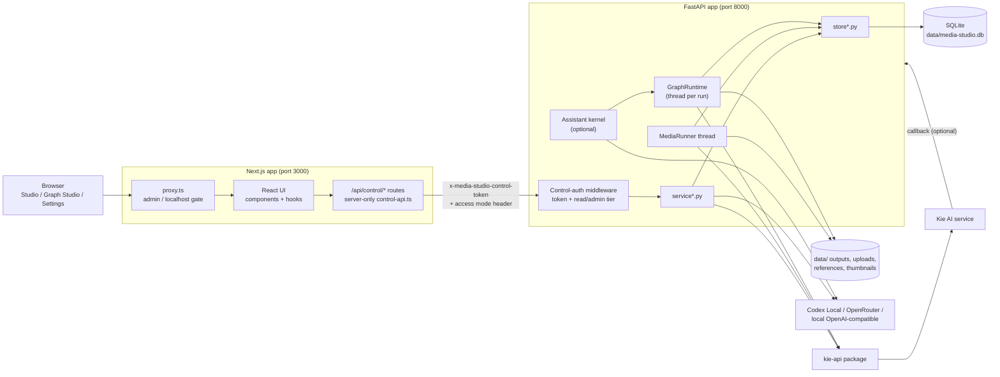
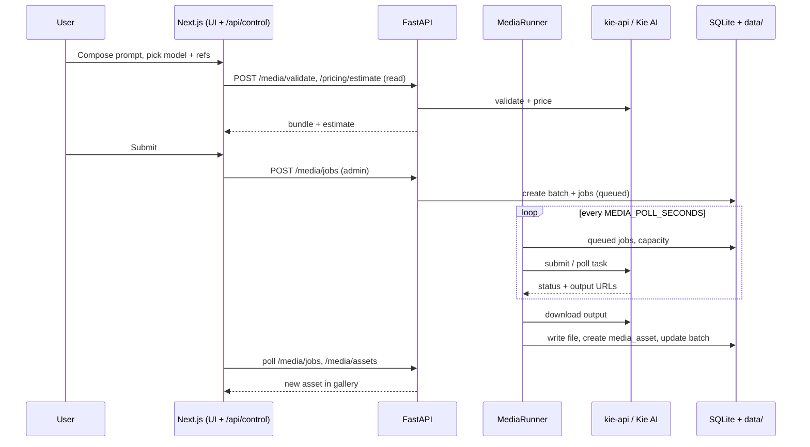

# Media Studio: architecture overview, component guide and improvement ideas

This document explains what Media Studio is, how its parts fit together, and where the project could be improved. It is based on a read-through of the repository at version 1.0.5 (`main`). It is a guide for contributors and maintainers. Existing contracts in `docs/` (Graph Studio, Media Assistant, presets, runtime) stay authoritative for their own areas, and this document links to them rather than repeating them.

Figures such as line counts and test counts are snapshots from the review and will drift.

---

## 1. What the project is

Media Studio is a **local-first creative workspace** for AI media generation. A user runs it on their own machine and uses it to:

- generate and revise **images** (GPT Image, Nano Banana) and **video** (Seedance, Kling) through the [Kie AI](https://kie.ai) provider;
- keep a searchable **local library** of outputs, references, projects and presets;
- build repeatable **Graph Studio** workflows on a visual node canvas, including audio (Suno) and local ffmpeg-style media operations;
- optionally use LLMs for **prompt enhancement and drafting** (Codex Local, OpenRouter, or a local OpenAI-compatible endpoint);
- optionally use the experimental **Media Assistant**, a Codex-backed agent that proposes graph edits, presets and recipes for the user to review.

Everything persistent (SQLite database, uploads, outputs, thumbnails, logs) lives under `./data`. Only generation and LLM requests leave the machine.

### Key design principles visible in the code

| Principle | Where it shows up |
| --- | --- |
| **Local ownership of data** | `data/` is gitignored and "never cleaned" by launchers; SQLite is the system of record. |
| **Provider logic lives outside the app** | Model specs, pricing, validation and submission come from the companion `kie-api` package, wrapped by `kie_adapter.py`. |
| **Backend defines the contract, UI renders it** | Graph node definitions are served by the API (`/graph/node-definitions`); the web app builds the canvas from them. |
| **Review before spend** | Assistant graph edits and generation runs are separate approval steps. Cost estimates are shown before submit. |
| **Defence in depth for a local app** | Browser to Next proxy to FastAPI, with a shared control token, read/admin tiers and localhost-only defaults. |
| **Guardrails against sprawl** | `scripts/check_file_size_guardrails.py`, style-drift checks, repo hygiene checks and quality-gate scripts. |

---

## 2. Repository layout

```text
media-studio/
├── apps/
│   ├── api/                 FastAPI backend (Python)
│   │   ├── app/
│   │   │   ├── main.py            HTTP routes, lifespan startup, control-auth middleware
│   │   │   ├── service*.py        Business logic (validation, submit, enhancement, publish)
│   │   │   ├── store*.py          SQLite access + schema/migrations + seed data
│   │   │   ├── runner.py          Background job poller (embedded thread)
│   │   │   ├── kie_adapter.py     Wrapper around the external kie_api package
│   │   │   ├── graph/             Graph Studio engine (compiler, validator, runtime, executors)
│   │   │   ├── assistant/         Media Assistant "kernel", routes, plans, tools
│   │   │   └── *_provider.py      Codex Local and external LLM providers
│   │   └── tests/                 ~870 pytest test functions
│   └── web/                 Next.js 16 / React 19 frontend
│       ├── app/                   Pages + `/api/control/*` proxy routes
│       ├── components/            Studio, Graph Studio, presets, settings, models UI
│       ├── hooks/studio/          Studio state hooks (composer, gallery, polling, ...)
│       ├── lib/                   Control API client, types, helpers, sharing formats
│       └── proxy.ts               Next middleware: admin-access gate
├── content/                 Starter graph workflows, presets, recipe docs
├── docs/                    Product, setup, runtime and design documents
├── ops/                     launchd, systemd, PM2, supervisord definitions
├── scripts/                 Onboarding, launchers, quality gates, smoke tests (~80 files)
├── specs/                   Generated OpenAPI spec
├── .codex/skills/           Codex skill for authoring graph workflows
└── data/                    (gitignored) database, media, logs, runtime state
```

The sibling repository **`../kie-api`** is a required runtime dependency. It is not vendored. It is located via `MEDIA_STUDIO_KIE_API_REPO_PATH` or the default `../kie-api`, and its virtualenv is the "shared Python environment" the scripts use.

---

## 3. System architecture



### Request path

1. The browser only ever talks to the **Next.js server**. Pages under `/studio`, `/settings`, `/presets`, `/models`, `/pricing`, `/jobs`, `/setup` and `/api/control/*` are protected by `proxy.ts`. It requires Basic auth if `MEDIA_STUDIO_ADMIN_USERNAME` and `MEDIA_STUDIO_ADMIN_PASSWORD` are set. Otherwise it allows only loopback traffic, or private-network traffic if explicitly enabled.
2. Next route handlers under `apps/web/app/api/control/**` use the `server-only` `lib/control-api.ts` client to call FastAPI. They attach the shared **control token** and an access mode (`read` or `admin`).
3. FastAPI's `enforce_control_access` middleware (`control_auth.py`) checks the token and tier. GET/HEAD/OPTIONS and a few side-effect-free POSTs (validate, estimate, prompt-context, enhance-preview) need `read`. All other `/media/*` mutations need `admin`. `/health` and the Kie callback are exempt.
4. Route handlers delegate to `service*.py` (logic) and `store*.py` (SQLite).

Because the browser never holds the control token, the FastAPI port can stay bound to `127.0.0.1` while the web tier does the access control.

---

## 4. Components in detail

### 4.1 Backend: FastAPI (`apps/api/app`)

#### Configuration (`settings.py`, `control_auth.py`)

- Settings are read from environment variables, with `.env` loaded from the repo root.
- Outside `development`/`dev`/`test`, the app **refuses to start** with a missing, default or placeholder control token. This is a good fail-closed choice.
- `MEDIA_STUDIO_INSTALL_ID` is derived from the DB and data paths if unset. It isolates browser-side state between installs.
- `MEDIA_ENABLE_LIVE_SUBMIT` plus a `KIE_API_KEY` gate real provider calls. Without them the runner **simulates** jobs, generating fake outputs. This allows safe onboarding and tests.

#### Persistence (`db.py`, `store*.py`, `store_schema.py`)

- Plain `sqlite3` with a per-call connection context manager (`get_connection`). There is no ORM.
- `store.py` is a facade over focused modules: `store_graph`, `store_assistant`, `store_reference_media`, `store_llm_usage`, `store_seed_*`, `store_preset_*`.
- `store_schema.py` (about 2,000 lines) owns table creation and **migrations** (`schema_meta`, `schema_migrations`). It optionally backs the DB up before migrating (`MEDIA_AUTO_BACKUP_BEFORE_MIGRATION`).
- Main table groups:
  - **Studio:** `media_projects`, `media_batches`, `media_jobs`, `media_job_events`, `media_assets`, `reference_media`, `media_project_references`.
  - **Configuration:** `media_presets`, `prompt_recipes`, `media_system_prompts`, `media_enhancement_configs`, `media_queue_settings`, `media_model_queue_policies`.
  - **Graph:** `graph_workflows`, `graph_workflow_versions`, `graph_templates`, `graph_runs`, `graph_run_nodes`, `graph_run_events`, `graph_artifacts`, `graph_node_definitions_cache`.
  - **Assistant and usage:** `assistant_sessions`, `assistant_messages`, `assistant_attachments`, `assistant_plans`, `assistant_turn_usage`, `media_external_llm_usage`.

#### Studio generation pipeline (`service.py`, `runner.py`, `kie_adapter.py`)

A single-image or single-video generation flows like this:

1. **Validate.** `POST /media/validate` builds a validation bundle (`build_validation_bundle`). It resolves presets and system prompts, applies prompt context, and validates the request through `kie_api`.
2. **Estimate.** `POST /media/pricing/estimate` returns credit and USD estimates. It is duration-aware for video and motion-control models.
3. **Optional enhance.** `POST /media/enhance/preview` runs the configured LLM enhancement for the model and returns a proposed prompt.
4. **Submit.** `POST /media/jobs` creates a **batch** of **jobs** (`submit_jobs`). Queue limits and per-model concurrency policies are applied.
5. **Run.** `MediaRunner` is an embedded daemon thread started in the FastAPI lifespan. Every `MEDIA_POLL_SECONDS` it:
   - starts queued jobs up to `max_concurrent_jobs`;
   - prepares and submits requests via `kie_adapter` (or simulates them when live submit is off);
   - polls provider tasks;
   - downloads outputs and calls `publish_job_artifact` to register `media_assets`;
   - recomputes batch counts.
6. **Callback (optional).** `POST /media/providers/kie/callback` lets Kie push completion. It is verified, and only trusted output URLs are accepted.
7. **Recovery.** On startup, `reconcile()` dedupes assets, repairs queue positions, resets invalid active jobs and re-attaches to jobs that already have provider task IDs.

Retry (`build_retry_submit_request`) rebuilds a submission from the stored job. Create Revision restores prompt, model, options and references.

#### Provider adapter (`kie_adapter.py`)

- Lazily imports `kie_api` and prepends the configured repo path to `sys.path`. It drops stale module copies if a different `kie_api` was already imported.
- Exposes models, specs, pricing snapshots (cached, refreshed on startup if stale), credit balance, cost estimation, request validation and preflight, submission, polling, download and callback verification.
- Adds Studio-specific enrichment, such as Kling motion-control duration handling and "exposed vs hidden" model flags.

#### LLM providers (`enhancement_provider.py`, `codex_local_provider.py`, `external_llm_usage.py`)

- Three prompt-tool backends: **Codex Local** (talks to a local Codex App Server and manages skill sessions with a reaper thread), **OpenRouter**, and a **local OpenAI-compatible** endpoint.
- External spend and tokens are recorded in `media_external_llm_usage` and surfaced separately from KIE credits.

### 4.2 Graph Studio engine (`apps/api/app/graph`)

Graph Studio is a DAG workflow system. Each workflow is a JSON document of nodes, edges and fields (`GraphWorkflow` in `graph/schemas.py`).

| Stage | Module(s) | Role |
| --- | --- | --- |
| **Node definitions** | `registry.py`, `system_nodes*.py`, `model_option_fields.py` | Builds the catalogue of node types. System nodes (prompt, load/save, image/video/audio ops, preview, debug) are code-defined. **Model nodes are generated from the Kie model registry**, so new models appear as nodes without UI changes. Definitions are cached in `graph_node_definitions_cache`. |
| **Normalization** | `normalization.py` | Materialises defaults and migrates older workflow shapes. |
| **Validation** | `validator.py`, `definition_validator.py`, `validator_prompt_recipe.py` | Port-type compatibility, required fields, graph cycles, recipe constraints. |
| **Compilation** | `compiler.py` | Produces an execution plan with dependency order. |
| **Execution** | `runtime.py`, `executors/*` | `GraphRuntime` registers about 40 executors keyed by node type. Each run executes on its own daemon thread (`start_run`), publishing outputs along edges through a `GraphExecutionContext`. |
| **Caching and resume** | `execution_cache.py`, `artifacts.py`, `result_binding.py` | Reuses prior outputs when inputs are unchanged. Supports recovering interrupted runs on startup. |
| **Cancellation** | `cancellation.py` | A cooperative flag in the DB, polled by executors. Also cancels in-flight Kie jobs. |
| **Streaming status** | `events.py`, `routes.py` (`/runs/{id}/events/stream`) | Persisted run events, streamed to the UI. |
| **Costing** | `pricing.py`, `/graph/estimate` | Pre-run estimates, plus actual credits and LLM cost aggregated after the run. |
| **Storyboards** | `storyboard_*.py`, `executors/storyboard_ops.py` | Compile storyboards, render storyboard sheets, check metadata and trilogy quality. |

The `KieModelExecutor` is the bridge to the Studio job system: graph model nodes submit real Kie jobs, wait on them, and bind outputs back to the graph.

Documents describing the intended contract: [`graph-studio-design.md`](graph-studio-design.md), [`graph-studio-node-library.md`](graph-studio-node-library.md), [`graph-studio-node-authoring.md`](graph-studio-node-authoring.md), [`graph-studio-node-extension-architecture.md`](graph-studio-node-extension-architecture.md).

### 4.3 Media Assistant (`apps/api/app/assistant`, experimental)

- Opt-in via `NEXT_PUBLIC_MEDIA_STUDIO_ASSISTANT_DEBUG=1`. The router is only mounted if enabled, and it requires a working Codex Local login.
- It is structured as a **kernel** with specialised sub-kernels (`kernel.py`, `story_kernel.py`, `preset_kernel.py`, `recipe_kernel.py`) and tool modules (`kernel_tools.py`, `artifact_recommendation_tools.py`).
- The flow is: session and messages, then **plans** (`graph_plan.py`, `production_plan.py`), then **review**, then **apply** (`POST /assistant/plans/{id}/apply`), then a separate **run confirmation** (`run_confirmation.py`).
- Supporting concerns are split into small modules: `canvas_context`, `conversation_history`, `graph_diff`/`graph_edits`, `graph_outcome`, `planning_recovery`, `reference_analysis`, `provenance`, `turn_trace`, `cancellation`, `limits`/`tool_limits`, prompt assets in `prompts/`, and policy JSON (`reply_policy.json`, `preset_capabilities.json`).
- The kernel reaches its model through a provider-neutral `AssistantRuntime` seam (`apps/api/app/assistant_runtime/`). Codex Local is the supported implementation, and an experimental OpenAI-compatible runtime sits behind a flag. See [`assistant-runtime-contract.md`](assistant-runtime-contract.md).
- It has the heaviest test coverage in the repo (about 25 assistant-specific test files, plus its own CI workflow and conversation-probe scripts).

Related docs: [`media-assistant.md`](media-assistant.md), [`media-assistant-setup.md`](media-assistant-setup.md), [`assistant-graph-outcomes.md`](assistant-graph-outcomes.md).

### 4.4 Frontend (`apps/web`)

- **Stack:** Next.js 16 (App Router), React 19, Tailwind 4, `@xyflow/react` for the node canvas, Vitest and Testing Library, and `sharp`/`jszip` for thumbnails and bundles.
- **Pages:** `/studio` (main composer and gallery), `/graph-studio`, `/presets`, `/prompts`, `/models`, `/pricing`, `/jobs`, `/settings/*`, `/setup`.
- **Server routes:** `/api/control/**` are thin server-side proxies to FastAPI. They validate and normalise payloads, shape pagination and responses (`pagination.ts`, `responses.ts`), and handle some local file work (thumbnail storage, reference-media import, output-folder reveal).
- **Control client:** `lib/control-api.ts` and `lib/control-api-media.ts` are `server-only` and hold the token. `lib/types.ts` mirrors API shapes. The checked-in `specs/media-studio-openapi.json` is produced by `scripts/generate_api_specs.py`.
- **State management:** large coordinator components with domain hooks, with no global state library:
  - `components/media-studio.tsx` (about 2,450 lines) coordinates the Studio screen, backed by `hooks/studio/*`: composer, gallery feed with cursor pagination, polling and a poll scheduler, attachments, project workspace, reference library, restore/revision.
  - `components/graph-studio/graph-studio.tsx` (about 2,200 lines) coordinates the canvas, backed by many `creative-assistant-*` components for the Assistant dock.
- **Sharing formats:** `preset-sharing.ts`, `prompt-recipe-sharing.ts` and graph template export/import allow bundles to move between installs.
- **Testing:** about 180 Vitest files, concentrated on hooks, route handlers, helpers and Assistant UI states.

### 4.5 Content and presets (`content/`, seed modules)

- `store_seed_presets.py` and `store_seed_prompt_recipes.py` install starter presets and prompt recipes (with assets in `app/seed_assets`).
- `content/graph-workflows/*.media-studio-graph.json` are portable starter workflows.
- Media Presets are templates with editable fields, image slots, model defaults and thumbnails. Prompt Recipes are reusable LLM instructions. They are deliberately distinct. See [`media-studio-preset-system.md`](media-studio-preset-system.md).

### 4.6 Runtime, ops and tooling (`scripts/`, `ops/`)

- **Onboarding:** `onboard_{mac,linux,windows}` create the `.env`, install dependencies, initialise the DB, seed presets and probe Codex.
- **Launchers:** `run_studio*.{sh,ps1,mjs}` start API and web in one terminal, pick free ports, wait for health, open the browser, and stream prefixed logs (`[api]`, `[web]`).
- **Supervision:** `ops/` has launchd, systemd, PM2 and supervisord definitions. See [`runtime-and-supervision.md`](runtime-and-supervision.md).
- **Quality gates:** `run-quality-gates` runs repo hygiene, file-size and style-drift checks, pytest, Vitest, lint, typecheck, a production build and a Playwright smoke test. `run-release-gates` and `run-full-release-gates` extend this. CI (`.github/workflows`) runs hygiene, Windows onboarding tests, full quality gates, and a separate Assistant gate. All of them use **Python 3.11**.
- **DB tooling:** backup, migration status, and "clean DB" scripts.

---

## 5. How the pieces work together: end-to-end walkthroughs

### 5.1 Generate an image in Studio



### 5.2 Run a Graph Studio workflow

1. The UI loads node definitions from `/graph/node-definitions`. Kie models are included, so the palette follows the model catalogue.
2. The user edits the canvas. Workflows are saved with versioning (`graph_workflow_versions`).
3. `POST /graph/estimate` and `/workflows/{id}/validate` give cost and structure feedback.
4. `POST /graph/workflows/{id}/runs` normalises, compiles and persists a `graph_run` with per-node rows, then starts a thread.
5. The runtime executes nodes in prioritised dependency order. Local nodes (ffmpeg-style transforms, slicing, storyboard sheets) run in-process. `KieModelExecutor` submits Kie jobs and waits.
6. Events are written to `graph_run_events` and streamed to the UI. Artifacts are registered. Failures skip downstream queued nodes. Cancel is cooperative.
7. On API restart, interrupted runs are recovered or marked failed.

### 5.3 Assistant proposes and applies a change

1. The user sends a message in the Graph Studio dock, together with the canvas context.
2. The kernel (with Codex Local) inspects the workflow and produces a **plan** and graph diff.
3. The UI shows the proposal. The user **applies** it, which edits the canvas.
4. Starting a run is a separate confirmation (`run_confirmation.py`) that shows the estimated cost.
5. Outcomes are summarised back to the conversation, preserving provenance.

---

## 6. Strengths

- **Clear layering and consistent facades.** `service`/`store` facades over focused modules, with explicit file-size guardrails documenting known large files and their owners.
- **Secure local-first defaults.** The token is fail-closed outside dev. The web tier is localhost-only unless credentials are set. The media file resolver confines paths to `data/` and excludes runtime internals.
- **Safe-by-default generation.** Simulated outputs when live submit is off, estimates before spend, and a separate approval step for Assistant runs.
- **Recovery-minded runtime.** Startup reconciliation for jobs and graph runs, resume of existing provider tasks, and cached node outputs.
- **Model catalogue drives UI.** New Kie models flow to Studio and Graph nodes through the registry with little app code.
- **Strong test and process discipline.** About 870 backend tests, about 180 frontend test files, scripted quality and release gates, and a hygiene check for publication safety.
- **Thorough documentation** for setup on three operating systems, plus design docs with explicit "intent vs implemented" labelling.

---

## 7. Risks and improvement opportunities

Items are grouped by theme and roughly ordered by value for effort within each group. Each is a suggestion based on code reading, not a confirmed defect. Verify before acting.

### 7.1 Reliability and platform compatibility

1. **Test on the Python version users actually run.** The "Python 3.14 `Traversable`" failure ([write-up](python-314-traversable-import-fix.md)) was invisible because CI only runs Python 3.11 while Homebrew now installs 3.14. Add a CI matrix (3.11, 3.12, 3.13, 3.14) for the API tests. Run it in `kie-api` as well, since that is where the break occurred.
2. **Make `kie_api` import failures obvious.** Startup currently logs a warning ("KIE model startup diagnostics failed") and continues. The app then looks healthy while `/media/models` returns 500. Consider a `/health` field (or a failing readiness check) for "provider package importable", surfaced in the UI header status. Also wrap the lazy import so users get a clear message rather than a stack trace.
3. **Declare the `kie-api` dependency explicitly.** Today it is a sibling directory discovered through `sys.path` manipulation (`kie_adapter._maybe_add_kie_repo_to_path`) and a shell helper. Options:
   - a pinned version or git ref check at startup (`kie_spec_version` is already logged),
   - a `pyproject` extra or `requirements` file that installs it editable,
   - a compatibility range the app validates and reports on.
4. **SQLite concurrency settings.** `db.py` opens a fresh connection per call and sets no pragmas. The app has several concurrent writers: request handlers, the runner thread, one thread per graph run, and the Assistant. Consider `PRAGMA journal_mode=WAL`, `busy_timeout`, and `foreign_keys=ON` at connect time. This reduces `database is locked` errors under load and improves reader/writer concurrency. Add a regression test that exercises concurrent runner and API writes.
5. **Safer default data location.** `settings.py` falls back to `/tmp/media-studio.db` and `/tmp/media-studio-data` if env vars are unset. The scripts always set them, but running `uvicorn` directly would silently store user work in a temp directory that the OS may clear. Default to the repo `data/` directory (or a user data dir) instead, or refuse to start without explicit paths outside tests.
6. **Python version declaration.** `apps/api/pyproject.toml` says `requires-python >=3.9`, while the code uses newer idioms and CI uses 3.11. Align the declared minimum with what is tested.

### 7.2 Architecture and scalability

1. **Thread-per-run graph execution and an embedded runner.** This is simple and fine for a single-user desktop tool. For heavier use, consider a bounded executor with a global cap on concurrent graph runs. Per-run threads can currently multiply with the runner's own concurrency, and each can hold ffmpeg subprocesses. A small job queue abstraction would also make future out-of-process workers possible without rewriting executors.
2. **Cancellation via DB polling.** `is_cancel_requested()` reads the run row every time it is checked. Cache with a short TTL or use an in-memory `threading.Event` per run, keeping the DB as the durable record.
3. **Polling-based UI updates.** The Studio uses client polling (`use-studio-polling`, a poll scheduler). Graph runs already have an SSE stream. Extending server-sent events to jobs and batches would cut request volume and latency, and simplify the polling hooks.
4. **Migrations in one 2,000-line file.** `store_schema.py` mixes table DDL (some tables appear twice, such as `prompt_recipes` and `graph_artifacts`, in bootstrap and migration paths) with migration logic. Consider numbered, individually testable migration modules with one canonical schema snapshot test. The existing `test_store_schema_migrations.py` is a good base.
5. **Typed store layer.** Store functions return plain dicts, with JSON columns parsed ad hoc. Typed row models (Pydantic or dataclasses) at the store boundary would catch shape drift early and reduce defensive `isinstance(...)` code, as seen throughout `runtime.py` and `runner.py`.
6. **Generated API client for the web app.** `specs/media-studio-openapi.json` is generated, but `lib/types.ts` and `control-api.ts` are hand-maintained mirrors. Generating TS types (for example `openapi-typescript`) and adding a CI drift check would remove a class of API/UI mismatches.

### 7.3 Code health and maintainability

1. **Burn down the file-size exemptions.** `media-studio.tsx` (about 2,450 lines), `graph-studio.tsx` (about 2,200), `store_schema.py` (about 2,000), `codex_local_provider.py` (about 1,575), `service.py` (about 1,400) and `main.py` (about 1,100) all rely on release caps whose comments say "split in a follow-up". Schedule the extractions and ratchet the caps downward as each lands.
2. **Split `main.py` into routers.** It holds about 90 routes in one module. FastAPI `APIRouter` modules (`models`, `presets`, `recipes`, `projects`, `references`, `jobs`, `assets`, `settings`) would mirror the existing `graph` and `assistant` routers and shrink the lifespan/bootstrap file.
3. **Separate Suno-specific logic from `runner.py`.** It contains Suno audio and cover extraction helpers alongside generic job polling. Moving provider-specific output parsing to its own module (or into `kie_adapter`/`kie-api`) keeps the runner generic.
4. **Executor registration by discovery.** `GraphRuntime.__init__` hand-lists about 40 executors. A decorator/registry pattern, plus a test that every system node definition has an executor, would remove a manual-sync step. This also supports the proposed extension architecture.
5. **Dependency declaration gaps.** The API's `pyproject.toml` lists FastAPI, uvicorn, pydantic, multipart and httpx. The code also imports `dotenv` (`settings.py`), `yaml` and others through `kie-api`. Make sure every direct import is declared, so the app does not rely on whatever happens to be in the shared venv.

### 7.4 Security and operations

1. **Default dev token.** In `development` the API accepts a well-known token (`media-studio-local-control-token`). That is acceptable for loopback, but make sure `onboard_*` always generates a random `MEDIA_STUDIO_CONTROL_API_TOKEN`, and warn in `/health` or the UI when the default is active, especially if `MEDIA_STUDIO_ALLOW_PRIVATE_NETWORK_ACCESS=true`.
2. **Token comparison.** `validate_control_request` compares tokens with `!=`. Use `hmac.compare_digest`. Practical risk is low on loopback, but it is a one-line hardening.
3. **Callback endpoint exposure.** `/media/providers/kie/callback` bypasses control auth by design. It does verify requests and trusted URLs. Keep it behind that verification, add rate limiting or size limits, and document the tunnel/reverse-proxy requirements when `MEDIA_STUDIO_PUBLIC_API_BASE_URL` is used.
4. **Secrets at rest.** Provider keys come from `.env`. LLM provider settings in DB records are stored (the public config helper redacts them on read). Document where keys are persisted, and consider the OS keychain as an optional backend for the KIE and OpenRouter keys.
5. **Uploads.** Reference import has a byte cap (`MEDIA_REFERENCE_IMPORT_MAX_BYTES`). Apply the same discipline to assistant attachments and graph media loads, including MIME sniffing and image decompression limits.
6. **Backups.** Backups happen before migrations and through a script. Offer scheduled, rotated DB backups and a "restore" flow in Settings, since `data/` is the user's irreplaceable library.

### 7.5 Product and UX enhancements

1. **Health and diagnostics panel.** A single "System status" view covering `kie_api` import and spec version, pricing snapshot age, Codex login, ffmpeg availability, DB version and disk usage, and runner/supervisor mode. Much of this data is already produced by `model_diagnostics()` and `/health`.
2. **Provider abstraction.** The product is tied to Kie AI. If more providers are desired, the `kie_adapter` surface (models, price, validate, submit, poll, download) is already a good interface boundary. Formalise it as a `MediaProvider` protocol with Kie as the first implementation.
3. **Budgeting.** Add per-project or per-day credit and USD budgets with soft/hard limits. Estimates, actual credits (`creditsConsumed`) and LLM cost are already collected per job and run.
4. **Library features.** Tags and smart collections, similarity or prompt search over assets, bulk operations, duplicate detection (`deduplicate_assets_by_job_id` shows the pain point), and an export-project bundle (assets plus prompts plus settings).
5. **Graph Studio.** Workflow-level parameters (exposed inputs for reuse as "apps"), batch/iterate nodes (`executors/batch_ops.py` is currently an empty stub with no executors, so this looks like a reserved extension point), run comparison, node-level re-run from cache, and a graph-run history view with diff.
6. **Plugin story.** The extension architecture doc is a proposal. A first step could be declarative node packs (definition JSON plus a restricted set of built-in executors) before considering executable plugins.
7. **Accessibility and keyboard coverage.** Shortcuts exist for navigation. Audit the canvas and dock for screen-reader labels, focus order and reduced-motion handling.
8. **Packaging.** Install currently requires Git, Python, Node and a sibling `kie-api` checkout. A single-download desktop build (Tauri/Electron, or a packaged venv and prebuilt web bundle) would remove the biggest adoption barrier. `docs/release-packaging.md` is the natural place to track this.

### 7.6 Testing and CI

1. **Python matrix** (see 7.1.1), and a nightly job against `kie-api` `main`, so provider-side changes fail early.
2. **Contract tests between web and API.** Beyond the generated spec (7.2.6), run a small Playwright suite against a live API in simulated mode. This is partly there with `smoke_studio_playwright.mjs`. Extend it to presets, projects and a minimal graph run.
3. **Concurrency and soak tests** for the runner and graph runtime (queue limits, cancellation, restart recovery).
4. **Coverage reporting.** Add coverage for both pytest and Vitest, and track trends rather than absolute numbers.
5. **Python 3.14 bytecode.** The `.pyc` files seen in `git status` earlier are ignored by `.gitignore` and none are tracked, so no cleanup is needed.

---

## 8. Suggested roadmap

| Horizon | Items |
| --- | --- |
| **Quick wins (days)** | CI Python matrix; `hmac.compare_digest`; SQLite WAL, `busy_timeout` and `foreign_keys` pragmas; default data path away from `/tmp`; `kie_api` readiness surfaced in `/health` and the UI; decide whether to implement or remove the `batch_ops` stub; declare missing Python dependencies. |
| **Near term (weeks)** | Split `main.py` into routers; generate TS API types with a CI drift check; split the schema/migration file; SSE for jobs and batches; System status panel; scheduled DB backups. |
| **Medium term (1–3 months)** | Typed store layer; executor registry with a definition-to-executor test; bounded graph-run executor; extract the large Studio and Graph coordinators and lower their caps; budgets; `MediaProvider` protocol. |
| **Longer term** | Declarative node packs; packaged desktop distribution; optional multi-provider support; richer library (tags, search, export). |

---

## 9. Quick reference

| Task | Command |
| --- | --- |
| First-time setup (macOS) | `./scripts/onboard_mac.sh` |
| Start Studio (production mode) | `./scripts/run_studio_mac.sh` |
| Dev mode (API + web with reload) | `npm run dev` |
| Full quality gates | `npm run quality` |
| Assistant CI gate | `npm run quality:assistant-ci` |
| Release verification | `npm run release:verify` / `npm run release:verify:full` |
| Regenerate OpenAPI spec | `npm run generate:api-specs` |
| DB backup / migration status | `npm run db:backup` / `npm run db:migration-status` |

Default ports: API `127.0.0.1:8000`, web `127.0.0.1:3000`. Logs are in `data/runtime/`.

### Where to start reading the code

1. `apps/api/app/main.py`: routes, lifespan startup, control-auth middleware.
2. `apps/api/app/service.py` and `runner.py`: the generation lifecycle.
3. `apps/api/app/kie_adapter.py`: the provider boundary.
4. `apps/api/app/graph/runtime.py` and `registry.py`: Graph Studio execution and node catalogue.
5. `apps/web/proxy.ts` and `apps/web/lib/control-api.ts`: the web-to-API security boundary.
6. `apps/web/components/media-studio.tsx` and `apps/web/hooks/studio/`: the Studio UI.
